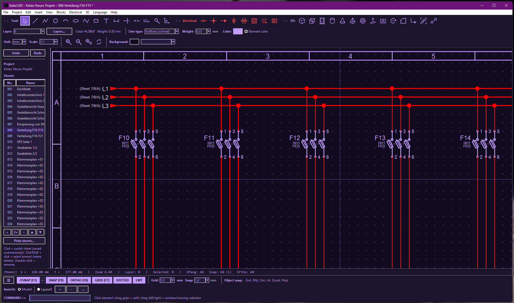
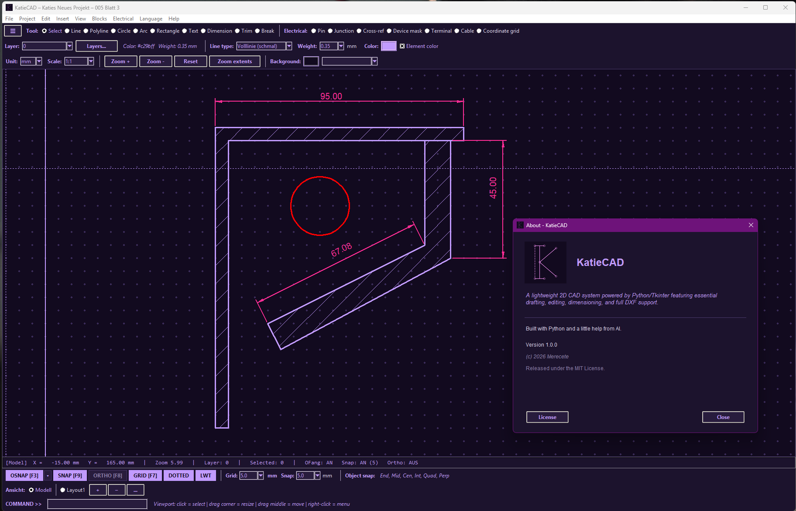
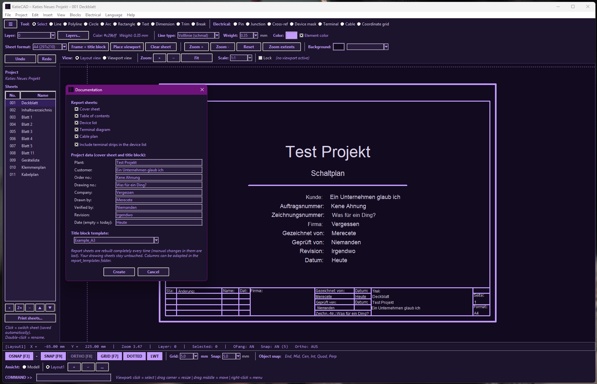
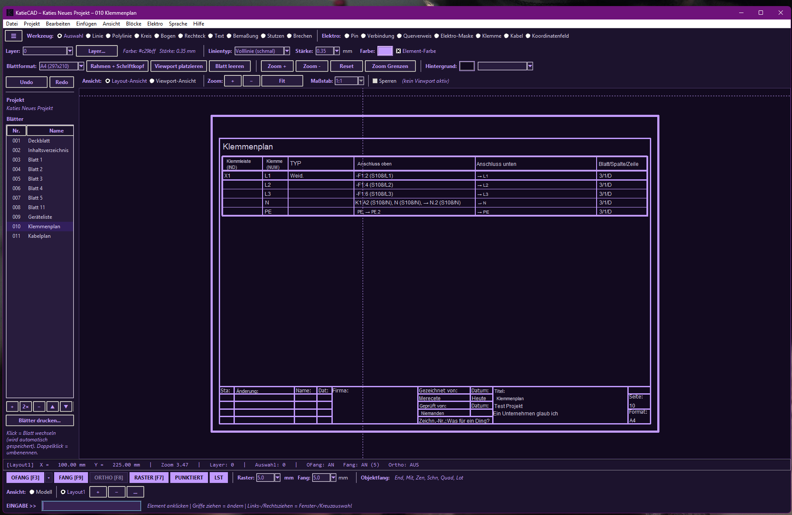

# KatieCAD

**KatieCAD is an open-source electrical CAD for switchgear construction, distribution boards and building installation – built with Python and Tkinter.**

It covers the complete workflow of an electrical project: draw circuit diagrams across several sheets, connect devices with wires, let cross references and device designations be generated automatically, and produce the documentation (cover sheet, table of contents, device list, terminal plan, cable plan) at the push of a button. At the same time it is a full 2D CAD: you can draw freely without a project and create, save and reuse your own blocks.

KatieCAD is under active development. The electrical "intelligence" is growing with every release; further checks and reports will follow.









## Features

### Electrical engineering
- **Projects with several sheets** – edited side by side, with title blocks and automatic fields
- **Wires, pins and junctions** – T-pieces, corners and crossings (with or without dot); wires are traced across sheets
- **Cross references** between sheets (outgoing / incoming)
- **Devices with electrical mask** – designation (IND), type (TYP) and function (PER); main and auxiliary contacts, automatic device references
- **Terminals and cables**, coordinate field, automatic wiring of connected points
- **Symbol library** with about 40 standard symbols (contactors, relays, fuses, switches, motors, transformers, …) and your own block library with a block browser
- **Documentation generator:** cover sheet, table of contents, device list, terminal plan, cable plan; customisable columns via `report_templates/`, CSV export and PDF output

### General CAD
- **Drawing tools:** Line, Polyline, Circle, Arc, Rectangle, Text, Hatching
- **Editing tools:** Move, Copy, Rotate, Stretch, Array, Trim, Break, Grip editing
- **Object snap:** Endpoint, Midpoint, Center, Intersection, Quadrant, Perpendicular, Nearest
- **Layers & styles:** Layer management, line types, line weights, element colours
- **Dimensions:** Linear, aligned, radius, diameter, decimal comma toggle
- **Blocks with attributes:** create, save (`*.katieblock`) and reuse
- **Layout view:** Paper space with viewports, standard scales, title block
- **DXF import/export** (via `ezdxf`), **DWG import** (via `ezdwg`)
- **Bilingual UI:** German and English (switchable at runtime)

## Download

Ready-made installers for **Windows**, **Linux** (`.deb` / `.tar.gz`) and **macOS** are available on the [Releases](../../releases) page.

## Run from source

Requirements:
- **Python 3.10+**
- `tkinter` (included in standard Python on Windows/macOS; on Linux install `python3-tk`)

```bash
git clone https://github.com/Merecete/KatieCAD.git
cd KatieCAD

## Windows:

python -m venv .venv

.venv\Scripts\activate

pip install -r requirements.txt

python main.py


## Linux/macOS:

python3 -m venv .venv

source .venv/bin/activate

pip install -r requirements.txt

python3 main.py
```

`requirements.txt` installs `ezdxf` (DXF) and `ezdwg` (DWG) and the other dependencies.

## Documentation

- [User guide (English)](docs/USER_GUIDE.md) · [Anleitung (Deutsch)](docs/ANLEITUNG.md)

## License

KatieCAD is released under the [MIT License](LICENSE).
