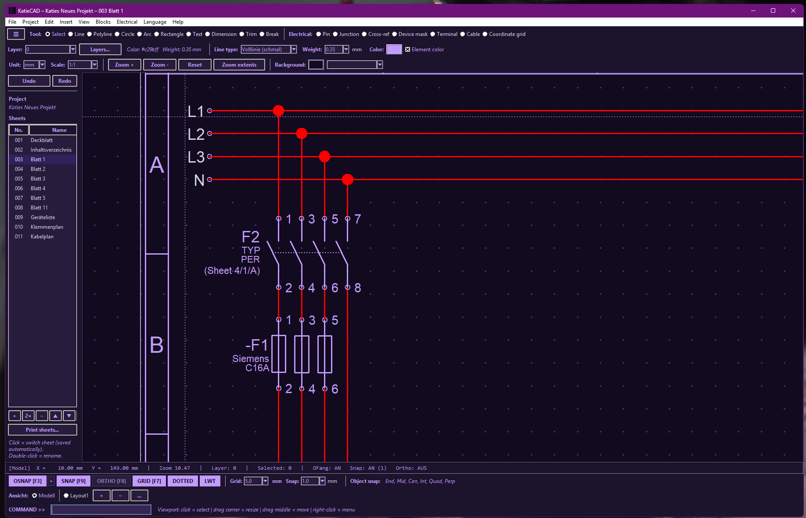

# KatieCAD

A lightweight 2D CAD drawing tool built with Python and Tkinter, featuring
core drawing, editing and dimensioning tools, layers, layout view with
viewports, plus DXF import/export.




## Features

- **Drawing tools:** Line, Polyline, Circle, Arc, Rectangle, Text, Hatch
- **Editing tools:** Move, Copy, Rotate, Stretch, Array, Trim, Break,
  Grip editing, Blocks (`BLOCK` / `INSERT` / `EXPLODE`)
- **Object snap:** Endpoint, Midpoint, Center, Intersection, Quadrant,
  Perpendicular, Nearest
- **Layers & styles:** Layer management, line types, line weights,
  element colors
- **Dimensions:** Linear, aligned, radius, diameter, decimal comma toggle
- **Layout view:** Paper space with viewports, standard scales, title block
- **PDF export** (built-in minimal PDF writer, no extra dependency)
- **DXF import/export** (via `ezdxf`, incl. `recover` for broken files)
- **DWG import** — ODA File Converter or LibreDWG (`dwg2dxf`) preferred,
  `ezdwg` as fallback
- **Bilingual UI:** German and English (switchable at runtime)

## Requirements

- **Python 3.10+** (required by `ezdwg`)
- **Tkinter** — included with standard Python on Windows/macOS;
  on Linux install your distro's Tk package (e.g. `python3-tk` / `tk`)
- Python packages (see `requirements.txt`):
  - `ezdxf >= 1.4` – DXF import/export
  - `ezdwg >= 0.12` – DWG import fallback
  - `Pillow >= 10.0` – logo in the info window

## Installation

### Arch Linux (AUR)

```bash
yay -S katiecad-git
# or: paru -S katiecad-git
```

This pulls in `python-ezdxf` (AUR) automatically. `python-ezdwg` is an
optional dependency for extended DWG import.

### Debian / Ubuntu (`.deb`)

Download the `.deb` from the
[GitHub Releases](https://github.com/Merecete/KatieCAD/releases) page, then:

```bash
sudo apt install ./katiecad_0.2.2_all.deb
katiecad
```

For extended DWG import (optional):

```bash
pip install --break-system-packages ezdwg
```

### Fedora / RHEL / openSUSE (`.rpm`)

Download the `.rpm` from the
[GitHub Releases](https://github.com/Merecete/KatieCAD/releases) page, then:

```bash
# Fedora / RHEL:
sudo dnf install ./katiecad-0.2.2-1.noarch.rpm
# openSUSE:
sudo zypper install ./katiecad-0.2.2-1.noarch.rpm
katiecad
```

### AppImage (any distro)

Download `KatieCAD-0.2.2-x86_64.AppImage` from
[GitHub Releases](https://github.com/Merecete/KatieCAD/releases), then:

```bash
chmod +x KatieCAD-0.2.2-x86_64.AppImage
./KatieCAD-0.2.2-x86_64.AppImage
```

The AppImage bundles `ezdxf`, `ezdwg` and `Pillow`. It still needs a
system `python3` with Tkinter (e.g. `python3-tk` on Debian/Ubuntu,
`tk` on Arch, `python3-tkinter` on Fedora).

### From source (Windows, macOS, Linux)

```bash
git clone https://github.com/Merecete/KatieCAD.git
cd KatieCAD

# Recommended: use a virtual environment
python -m venv venv
source venv/bin/activate        # Linux/macOS
venv\Scripts\activate           # Windows

pip install -r requirements.txt
python KatieCAD.py
```

> On Linux you also need Tk, e.g. `sudo apt install python3-tk`
> (Debian/Ubuntu), `sudo dnf install python3-tkinter` (Fedora) or
> `sudo pacman -S tk` (Arch).

### Build the installers yourself

```bash
./packaging/build-all.sh        # builds .deb + .rpm + AppImage into dist/
./packaging/build-deb.sh        # Debian/Ubuntu only
./packaging/build-rpm.sh        # needs rpmbuild
./packaging/build-appimage.sh   # needs appimagetool
```

Tagged pushes (`v*`) are built automatically by
[`.github/workflows/release.yml`](.github/workflows/release.yml) and
attached to the GitHub release.

## DWG import notes

`katiecad_cadimport.py` tries the following, in order:

1. **ODA File Converter** (`ODAFileConverter`) or **LibreDWG** (`dwg2dxf`)
   to convert DWG → DXF,
2. `ezdxf` to read the converted DXF,
3. `ezdwg` as a last resort for direct DWG parsing.

For best DWG results, install one of the external converters; `ezdwg`
alone handles only a subset of DWG files.

## Usage

Start the program (`katiecad`, the AppImage, or `python KatieCAD.py`)
and draw with the toolbar, the menus, or the command line at the bottom
of the window (both German and English commands work, e.g. `LINIE` /
`LINE`, `KREIS` / `CIRCLE`, `STUTZEN` / `TRIM`, `BLOCK`, `INSERT`,
`EXPLODE`).

Settings (currently the UI language) are stored per user:

- Windows: `%APPDATA%\KatieCAD\config.json`
- macOS: `~/Library/Application Support/KatieCAD/config.json`
- Linux: `$XDG_CONFIG_HOME/KatieCAD/config.json` (usually
  `~/.config/KatieCAD/config.json`)

## Project layout

| File | Purpose |
| ---- | ------- |
| `KatieCAD.py` | Entry point (`main()`) |
| `katiecad_app.py` | Tkinter UI, events, tools, state |
| `katiecad_core.py` | Data model, geometry, PDF writer |
| `katiecad_cadimport.py` | DXF/DWG import (`ezdxf`, ODA, LibreDWG) |
| `katiecad_dialogs.py` | Dialogs + license window |
| `katiecad_pdf.py` | PDF output (model/layout) |
| `katiecad_config.py` | Persistent user settings (language) |
| `katiecad_i18n.py` | UI texts DE/EN |
| `katiecad_manifest.py` | Module list + `VERSION` |
| `packaging/` | `.desktop`, launcher, `build-*.sh`, RPM spec, AUR `PKGBUILD` |

## Contributing

Pull requests are welcome. Please keep changes focused, byte-compile
clean (`python -m py_compile KatieCAD.py katiecad_*.py`), and validate
the desktop file (`desktop-file-validate packaging/katiecad.desktop`)
when touching packaging.

## License

MIT — see [LICENSE](LICENSE).
